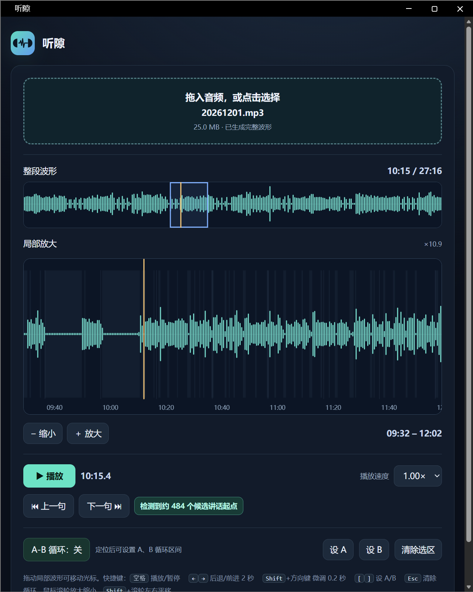

# 听隙

这是一个**完全离线、无需安装**的 Windows 英语听力工具。听隙适合逐句听写和反复精听。波形与停顿提示能帮你更快找到没听清的片段；用 A–B 循环和变速播放反复听，把时间花在辨认连读、弱读和句子细节上，而不是反复拖动进度条。适用于四六级、考研、雅思等英语听力材料的自主练习。作者自用开发，分享给同样需要精听工具的学习者。

## 界面预览

## 下载

在 [Releases](https://github.com/Wind-Shepherd/TingXi/releases/latest) 下载 `TingXi.exe`，双击运行时需要本机有 Edge；没有 Edge 时会尝试用默认浏览器打开。

程序页面会复制到 `%LOCALAPPDATA%\TingXi`。音频仍然只在本机读取，不会上传。浏览器和 Windows 自身可能使用各自的系统缓存。

## 播放操作

- 点击顶部大框选择 MP3/WAV/M4A，或拖入音频文件；波形覆盖整个录音。
- 局部波形上单击或拖动放置播放光标；滚轮放大缩小；按住 Shift 并滚轮横向平移。
- 定位到起点和终点后，分别点击“设 A”“设 B”来设置 A-B 循环。
- 左右方向键移动 2 秒，Shift+方向键微调 0.2 秒；空格播放/暂停。
- 上一句/下一句依据静音间隙作近似定位，不等于语音识别，噪声可能影响结果。
